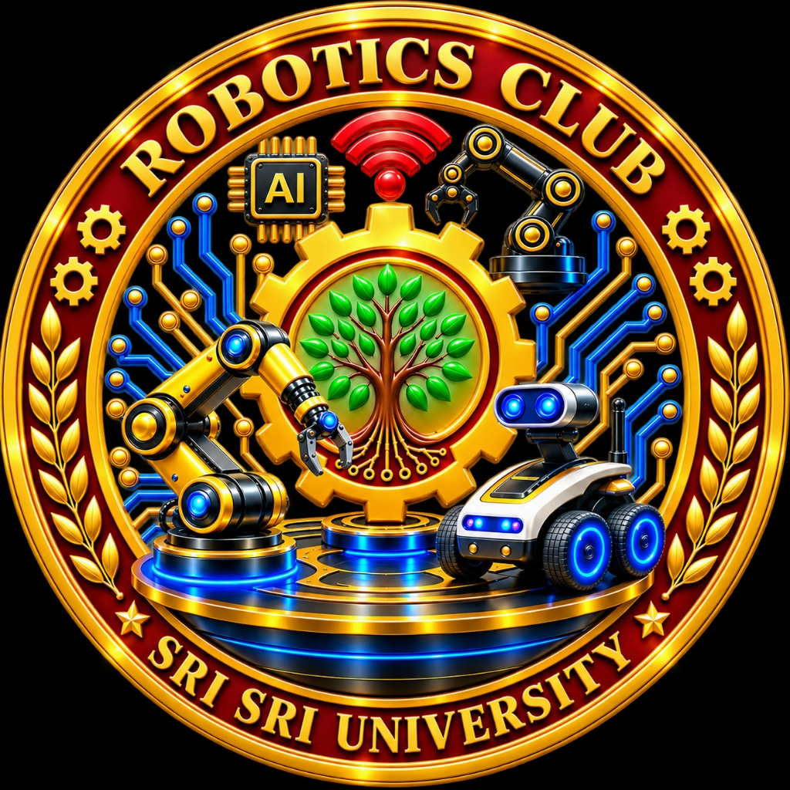

# KIOSK — Sri Sri University Autonomous AI Campus Robot (v1.0.7)

<div align="center">
  
  <h3>Engineered & Built by the <strong>Sri Sri University Robotics Club</strong></h3>
  <p><em>"Learn, Lead, Serve" • Sri Sri University • Cuttack, Odisha</em></p>
  <p><strong>Static Network IP: <code>172.17.0.1</code> | Release Version: <code>v1.0.7</code> (versionCode 7)</strong></p>
</div>

---

## 🌟 Executive Overview

**KIOSK** is an autonomous campus service robot developed by the **Sri Sri University Robotics Club**. It combines procedural robotic facial expression animations, an on-device bilingual voice assistant (English & Hindi) calibrated with a mature male baritone cadence matching the official vocal sample, live SLAM mapping & teleoperation, an interactive campus highlights guide with audio tours, live academic symposia schedules, and robust 3-tier embedded systems engineering.

The system runs on a **Realme Android Tablet (10.4")** mounted on the robot's polygon head, operating offline with zero cloud dependency required for speech recognition, text-to-speech, teleoperation, or navigation guidance.

---

## 📐 Application Architecture & Wireframe Flow

The user interface follows a clean, physical kiosk workflow designed for the robot's landscape tablet display:

```
┌─────────────────────────────────────────────────────────────┐
│ ① ROBOT FACE (Home & Standby)                               │
│ • Static IP 172.17.0.1 badge at top left                    │
│ • Procedural cyan glowing eyes & lip-sync mouth             │
│ • Automatic spoken welcome introduction                     │
│ • Stays on Face screen until explicitly touched             │
└──────────────────────────────┬──────────────────────────────┘
                               │ (Tap / Touch Screen)
                               ▼
┌─────────────────────────────────────────────────────────────┐
│ ② CAMPUS ROBOT HUB (Main Menu)                              │
│ • Top bar: Back to Face + SSU Brand + Club Logo             │
│ • 3 Large Expansive Touch Modules (Full Screen Coverage):   │
│   [ 1. Robo Info ]  [ 2. Map & SSU Info ]  [ 3. Sessions ]  │
│ • Quick Voice Assistant Microphone Bar                      │
└──────────┬───────────────────┼───────────────────┬──────────┘
           │                   │                   │
           ▼                   ▼                   ▼
┌──────────────────┐ ┌───────────────────┐ ┌──────────────────┐
│ ⑤ ROBO INFO      │ │ ③ MAP & SSU INFO  │ │ ④ SESSIONS &     │
│ • Club Story     │ │ • Real SLAM Map   │ │   AGENDA         │
│ • Club Emblem    │ │ • Teleop Joystick │ │ • 12 SSU Events  │
│ • 3-Tier Arch    │ │ • Landmark Tours  │ │ • Photo Banners  │
│ • Maker Space    │ │ • Audio Guides    │ │ • Key Takeaways  │
│ • Safety Relay   │ │ • Visiting Hours  │ │ • Entry Badges   │
└──────────────────┘ └───────────────────┘ └──────────────────┘
```

### Screen Breakdown
1. **Box ① — Robot Face Screen (`FaceScreen.tsx`):**
   * Displays animated glowing cyan eyes, responsive pupil tracking, blinking, and viseme audio reactivity.
   * Prominently displays network IP `172.17.0.1` at the top left.
   * Plays the introductory welcome speech and **remains on the Face screen** until the user explicitly taps or touches the display.
2. **Box ② — Campus Robot Hub (`HubScreen.tsx`):**
   * Clean industrial design: Primary Charcoal (`#30343B`), Secondary Silver (`#B0B4B8`), Dark components (`#202124`), Amber Accent (`#D49A36`), and Crisp White Cards (`#FFFFFF`).
   * Clean layout with window maximize/minimize buttons and bottom gallery bar completely removed for maximum touchscreen reliability.
   * 3 large interactive touch modules: **Robo Info**, **Map & SSU Info**, and **Sessions / Agenda**.
3. **Box ③ — Map, SLAM & Campus Info (`MapInfoScreen.tsx`):**
   * Real-time 2D SLAM Occupancy Grid (`/map`) canvas subscriber with live robot pose orientation (`/odom`).
   * Touch joystick for continuous 10Hz velocity teleoperation (`/cmd_vel`) with automatic deadman safety cutout.
   * Landmark directory with GPS satellite map and click-to-speak voice descriptions for Sri Sri University buildings.
4. **Box ④ — Sessions & Campus Agenda (`SessionsAgendaScreen.tsx`):**
   * Live schedule of 12 academic symposia, robotics demos, yoga masterclasses, and conferences with high-definition photo banners.
   * Filterable by date (*Today*, *Tomorrow*, *Upcoming*, *All*) and track (*Robotics & AI*, *Academic*, *Wellness*, *Cultural*, *Orientation*).
   * Spoken audio summaries and venue locating.
5. **Box ⑤ — Robo Info & Club Engineering (`RoboInfoScreen.tsx`):**
   * Features the official **Sri Sri University Robotics Club** gold emblem.
   * Documents the club origin story and university heritage (*"Learn, Lead, Serve"*).
   * Detailed 3-tier hardware breakdown and safety watchdog protocol.
   * Giant Kiosk Font Mode toggle for clear readability from distance.

---

## 🎙️ Calibrated Natural Male AI Voice Pipeline

The speech synthesis engine ([`src/services/textToSpeech.ts`](src/services/textToSpeech.ts)) is calibrated to mirror the deep, resonant male baritone voice from the official reference audio sample ([`public/voice-sample.mp3`](public/voice-sample.mp3)):

* **Native Android TTS Voice Auto-Resolution (`MainActivity.java`):** Automatically queries `tts.getVoices()` on Android and binds to the best UK/US male engine (e.g. `en-gb-x-rjs#male`, `en-us-x-sfg#male`), preventing Android from defaulting to high-pitched female voices.
* **Vocal Pitch:** Calibrated to **`0.75`** (deep baritone resonance matching `"I fear darkness hunts us..."`).
* **Cadence & Rate:** Calibrated to **`0.85`** (deliberate, steady, authoritative tempo).
* **Reference Audio Player:** Built-in audio player in **Settings** allows testing against [`public/voice-sample.mp3`](public/voice-sample.mp3) with one-click tone calibration.

---

## ⚙️ 3-Tier Hardware & Software Architecture

| Processing Tier | Hardware Unit | Operating Role | Technical Stack |
| :--- | :--- | :--- | :--- |
| **Tier 1 (Interface)** | **Realme Android Tablet 10.4"** | Procedural SVG face, Web Speech API (STT & TTS), Touch UI, Front Camera gaze | React 18, TypeScript, Vite, Tailwind CSS, Capacitor 8 |
| **Tier 2 (Navigation)** | **NVIDIA Jetson Edge Node** | ROS 1 / ROS 2 Nav2, 2D LiDAR SLAM, dynamic costmaps, obstacle deceleration | Ubuntu, ROS 2 Humble / Noetic, Python, WebSocket |
| **Tier 3 (Safety & Drive)** | **Arduino Mega 2560** | Planetary motor PWM, quadrature encoders, 300ms watchdog failsafe, E-Stop relay | Embedded C++, Serial Protocol @ 115200 baud |

---

## 📱 Android Tablet APK Installation (Release v1.0.7)

<div align="center">
  
  <p><em>Scan with tablet camera or Google Lens to download APK directly</em></p>
</div>

### Direct Download Links
* **Primary GitHub Release:**  
  [https://github.com/AmitAP1610/-Kiosk-Home-screen-Application-/releases/download/v1.0.7-apk/KIOSK-AMR-v1.0.7.apk](https://github.com/AmitAP1610/-Kiosk-Home-screen-Application-/releases/download/v1.0.7-apk/KIOSK-AMR-v1.0.7.apk)
* **Direct Raw Mirror (Fastest):**  
  [https://github.com/AmitAP1610/-Kiosk-Home-screen-Application-/raw/main/dist-apk/KIOSK-AMR-v1.0.7.apk](https://github.com/AmitAP1610/-Kiosk-Home-screen-Application-/raw/main/dist-apk/KIOSK-AMR-v1.0.7.apk)
* **Release Page:**  
  [https://github.com/AmitAP1610/-Kiosk-Home-screen-Application-/releases/tag/v1.0.7-apk](https://github.com/AmitAP1610/-Kiosk-Home-screen-Application-/releases/tag/v1.0.7-apk)

### What's New in v1.0.7:
1. **Autonomous Sequential Guided Escort System (A→B & Multi-Stop):**
   - **Stage 1 (Spoken Introduction):** Robot introduces itself verbally ("Namaste! I am Kiosk, your autonomous campus guide...") and states the escort route from Point A to Point B before initiating motion.
   - **Stage 2 (In-Transit Autonomous Navigation):** Dispatches `/goal_pose` to Jetson ROS 2 Nav2, monitors distance/progress, displays escort radar & telemetry, and delivers periodic verbal updates.
   - **Stage 3 (Destination Arrival & Briefing):** Upon reaching Point B, robot stops, announces arrival in calibrated baritone voice, and presents a rich on-site facility briefing sheet (building details, departments inside, hours, key amenities).
   - **Stage 4 (Sequential Advancement & Mission Storage):** Multi-stop tour sequences advance stop-by-stop, storing completed missions permanently in tablet `localStorage`.
2. **Native Deep Baritone Voice Modulation:** Calibrated pitch 0.74, rate 0.86, matched with reference voice sample.
3. **Official SSU Robotics Club Emblem:** Integrated app launcher icon and navigation branding.
4. **Android Clean Upgrade:** `versionCode 7` to force clean cache invalidation on tablets.

### Installation Steps on Tablet:
1. **Uninstall the old app** on your Realme tablet first to ensure WebView cache is purged.
2. Scan the QR code above or open the download link in Chrome on your tablet.
3. Tap **Install** (allow "Install unknown apps" if prompted).
4. Launch **KIOSK AMR** — it opens in fullscreen landscape!

---

## 🚀 Development & Build

```powershell
# Install dependencies
npm.cmd install

# Start local Vite development server
npm.cmd run dev

# Run TypeScript typecheck and build production assets
npm.cmd run build
```

Compiled cleanly with **Gradle 8.13**, **Android Gradle Plugin 8.13.0**, **Android SDK 36**, and **JDK 21**.

### Prerequisites
* **Node.js** (v18.0.0 or higher)
* **npm** (v9.0.0 or higher)

### Installation & Launch

```powershell
# 1. Clone or navigate to the repository
cd "c:\Users\amitk\OneDrive\Desktop\ROBOT FACE"

# 2. Install dependencies
npm.cmd install

# 3. Start local Vite development server
npm.cmd run dev
```

Open **`http://localhost:5173`** in Google Chrome or Android WebView on the tablet.

### Production Build

```powershell
npm.cmd run build
```

Build outputs are bundled to the `dist/` folder and optimized for low-latency tablet execution.

---

## 📜 License & Ownership
Copyright © 2026 **Sri Sri University Robotics Club**. Developed for autonomous campus navigation, visitor orientation, and student robotics research.
